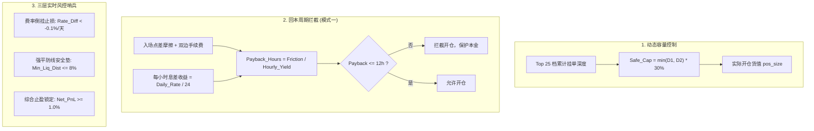

# Hummingbot Workspace Agent Guidelines & Living Memory (避坑实战与核心案例文档)

> **【核心使命与长效机制】**  
> 本文档是 Hummingbot 量化套利系统的**永续知识底座、避坑活账本与开发参考规范**。详细沉淀了本项目在架构二次开发、实盘与纸面预演（Dry-Run）调试、风控建模、前后端对账中**所有真实踩过的坑、解决过的核心 Bug、典型案例与最终解决方案**。  
> **【Agent 强制留档准则】**  
> 后续任何接入本项目的 AI Agent 或人类开发者必须遵循：  
> 1. **事前必读**：开工前必须完整阅读本文档，坚决避免重复犯错；  
> 2. **事后必存**：每次交互、排错或功能迭代中，一旦解决了新的核心问题、识别出新陷阱、优化了业务算法，**必须主动将该案例追加沉淀至本文档对应的案例库中**，保持知识库持续更新生长！

---

## 目录
1. [Agent 工作流与交互持续留档机制](#一agent-工作流与交互持续留档机制)
2. [十二大核心踩坑实战、Bug 根因与解决方案案例库](#二十二大核心踩坑实战bug-根因与解决方案案例库)
3. [量化套利核心财务口径与数学公式标准](#三量化套利核心财务口径与数学公式标准)
4. [两大套利流派与系统演进规范 (Mode 1 vs Mode 2)](#四大套利流派与系统演进规范-mode-1-vs-mode-2)

---

## 一、Agent 工作流与交互持续留档机制

### 1. Git Workflow & 自动语义化提交
- **任务完成自动提交**：每当完成代码编写、功能迭代、配置调整或 Bug 修复后，必须主动执行 Git 整理。
- **Conventional Commits 规范**：使用标准语义化前缀（`feat:`, `fix:`, `refactor:`, `chore:`, `docs:` 等），创建清晰提交并主动 `git push origin <branch>` 推送至远程 GitHub 仓库。
- **工作区整洁性**：严禁将临时日志文件（`*.log`）、临时数据库（`*.sqlite`）或容器临时生成物误提入版本库。

### 2. 交互与经验持续沉淀机制 (Continuous Knowledge Ledger)
- 严禁将宝贵的问答解释、报错排查过程遗忘在聊天上下文里。
- 每次解决核心痛点（如新报错、交易所 API 变动、财务口径分歧、风控拦截失效）后，必须按如下标准格式追加记录到第二章节案例库：
  - **案例背景与报错现象**
  - **技术根因剖析 (Root Cause)**
  - **最终解决方案与代码/配置实现**
  - **避坑铁律与复用建议**

---

## 二、十二大核心踩坑实战、Bug 根因与解决方案案例库

### 案例 1：Docker 容器 Root 权限蔓延引发 `[Errno 13] Permission denied`
- **报错现象**：在 Dashboard 的 `funding_rate_arb` 页面保存配置时，报错：  
  `保存失败: [Errno 13] Permission denied: '/home/neo/projects/hummingbot/hummingbot-dashboard/.../bots/conf/scripts/funding_arb_hyperliquid_binance_dry_run.yml'`
- **根因剖析**：Hummingbot 官方 Docker 镜像默认以 `root` (UID 0) 用户在容器内运行，映射到宿主机挂载卷（`bots/conf/scripts/`）生成的文件属主为 `root:root`。而宿主机 Dashboard 是普通用户（`neo`，UID 1000）进程，尝试写入时直接触发 Linux 文件系统只读保护。
- **最终解决方案**：
  1. 统一宿主机所有权：使用一次性 Alpine 容器批量修正属主：  
     `docker run --rm -v $(pwd):/work alpine chown -R 1000:1000 /work`
  2. 启动容器时指定或映射用户 ID，杜绝容器生成只有 root 可写的文件。
- **避坑铁律**：宿主机与容器挂载目录的所有配置文件，必须随时保持 UID 1000:1000 可写权限。

---

### 案例 2：Hummingbot 原生不支持跨所永续合约 Paper 模拟，导致无 Key 启动闪退
- **报错现象**：用户部署纸面模拟机器人时，实例加载数秒后直接闪退崩溃；日志提示缺少 API Key 或签名校验失败。
- **根因剖析**：Hummingbot 原生 Paper Trade 仅针对现货（Spot）设计；其衍生品永续合约（Perpetual）连接器强制在初始化阶段校验 API Key 签名，无法在不配 Key 的情况下完成启动。
- **最终解决方案**：
  1. 二次开发策略内核 [`v2_funding_rate_arb.py`](file:///home/neo/projects/hummingbot/hummingbot-api/bots/scripts/v2_funding_rate_arb.py)，新增 `dry_run: bool = True` 模式；
  2. 允许连接器使用公共行情通道免 Key 启动，在策略内部植入独立的 **Dry-Run 虚拟撮合与按期计息沙盒**（模拟订单成交、滑点走势、1h/8h 资金费划转）；
  3. 状态通过 MQTT 广播与 `/home/hummingbot/data/arbitrage_trades.json` 文件持久化透出。
- **避坑铁律**：开发永续合约纸面演练时，切勿依赖 Hummingbot 原生 Paper 撮合引擎，必须走自定义 Dry-Run 沙盒。

---

### 案例 3：Hyperliquid WebSocket 资金费率解析官方 Bug
- **报错现象**：Hyperliquid 永续连接器无法动态更新最新资金费率，或在接收 WebSocket 广播时抛出字段解析异常。
- **根因剖析**：上游官方 Hummingbot 在 `HyperliquidPerpetualAPIOrderBookDataSource` 中解析 WS 返回的 funding rate 消息结构时存在硬编码失配。
- **最终解决方案**：在策略初始化钩子 [`start()`](file:///home/neo/projects/hummingbot/hummingbot-api/bots/scripts/v2_funding_rate_arb.py#L240) 中动态注入 Monkey Patch，修正 WebSocket 资金费提取函数，并打上 `_funding_rate_patch_applied = True` 标识防重入。
- **避坑铁律**：上游开源库连接器常有接口滞后，遇到字段解析异常优先在策略层打 Monkey Patch 动态修补，无需重编译底层 C-Python 镜像。

---

### 案例 4：Dashboard 页面崩溃 `KeyError: 'diff_daily_pct'`
- **报错现象**：打开 Dashboard 实例详情页时，前端直接红屏崩溃，堆栈定位在 `KeyError: 'diff_daily_pct'`。
- **根因剖析**：策略底层 JSON 输出的市场比价字段名为 `daily_rate_diff_pct`，而前端读取时硬编码了旧字段名 `diff_daily_pct`。
- **最终解决方案**：前后端字段协议统一，前端对字段提取采用弹性容错取值：  
  `rate_diff = p.get("daily_rate_diff_pct", p.get("diff_daily_pct", 0.0))`。
- **避坑铁律**：前后端解耦的数据字典访问，严禁裸写 `dict['key']`，一律使用 `.get('key', default)` 确保容错。

---

### 案例 5：初始策略“零成交、无订单”与被动等待陷阱
- **报错现象**：机器人启动运行几小时，活跃持仓和交易记录全部为 0。
- **根因剖析**：原版策略配置是静态写死 4 个代币，而这 4 个代币当时在两所的利差极低，未达到设定的门槛，导致策略处于被动死等状态。
- **最终解决方案**：
  1. 开发全市场跨所扫描器，实时对齐 208 个跨所交易对并计算息差排行榜；
  2. 暴露前端雷达表，根据利差排行动态调整关注标的池，变“被动死等”为“主动雷达选品”。
- **避坑铁律**：固定币种静态名单必然会随行情失效，套利系统必须具备全市场动态扫描能力。

---

### 案例 6：固定单一货值引发次级市场“流动性击穿与自残式滑点”
- **报错现象**：小市值代币（如 SAND、2Z 等）开仓后，瞬间出现 -1% 甚至更严重的盘口浮亏。
- **根因剖析**：无脑设定固定开仓金额（如 $10,000），而二线合约盘口深度浅，大单直接吃穿买一卖一，滑点损失彻底抹杀了几天的资金费收益。
- **最终解决方案**：
  1. 引入**基于订单簿深度的动态容量算法（Dynamic Position Sizing）**；
  2. 采集双边交易所 Top 25 档挂单深度，开仓额严禁超过安全容量（默认 <= 30% 盘口深度）：  
     `Safe_Size = min(Depth1_Top25, Depth2_Top25) * 0.3`；
  3. 修复 `get_current_profitability_after_fees` 必须基于实际 `pos_size` 计算点差的 Bug，彻底消除假性滑点。
- **避坑铁律**：在次主流币上套利，必须动态按盘口深度控制仓位，严禁固定金额扫单。

---

### 案例 7：跨所异步结算周期（HL 1h vs BN 8h）引发的“负资金费”恐慌
- **报错现象**：开仓 1 小时后，用户发现“累计已收资金费”居然是负数，质疑利差计算做反了。
- **根因剖析**：Hyperliquid 每 1 小时结算一次，Binance 每 4 或 8 小时结算一次。在开仓后的前几个小时内，Hyperliquid 已经扣除了多头利息，而 Binance 空头利息尚未到结算点，账面暂时出现账期错位引发的虚假利息亏损。
- **最终解决方案**：在 UI 显著标注两所各自的倒计时，并明确说明对账原则：**必须以 8 小时完整周期对齐后的净现金流为准**。
- **避坑铁律**：跨交易所套利具有天然账期异步性，切忌以单次短周期结算误判整体策略。

---

### 案例 8：名义合约总货值 vs 实际投入本金（3x 杠杆）财务口径混淆
- **报错现象**：用户质疑“实缴本金 $12,466，3 倍杠杆下货值为什么才 $18,700，而不是 12,000 × 3 = 36,000？”
- **根因剖析**：对冲套利是**双边开仓**（一边做多、一边做空）。$12,466 本金被平分到多空两所（各 $6,233 保证金）。3 倍杠杆下，单边名义头寸为 $18,700，双边总持仓货值才是 $37,400。
- **最终解决方案**：前端 UI 彻底分列明确展示：
  - `真实实缴本金 (总保证金) = $12,466`
  - `单边对冲名义货值 = $18,700`
  - `双边合约总货值 = $37,400`
  - `ROE 年化回报率 = 24h现金流 × 365 / 真实实缴总本金`
- **避坑铁律**：对冲套利算力口径必须区分单边与双边，分母必须是真实双边保证金。

---

### 案例 9：盲目随时开仓与“回本周期黑洞”——落地模式一硬性拦截
- **报错现象**：用户敏锐发现“为什么别人的套利软件几天才响一次，而我们随时都在开仓？为什么一开仓净盈亏全都是负的？”
- **根因剖析**：原版策略关闭了入场摩擦检查（`trade_profitability_condition_to_enter: false`）。在日息差仅 0.15% 的情况下，开仓点差和手续费倒贴了 0.4%，需要持仓苦熬 64 小时才能回本；行情稍有波动便被止损割肉。
- **最终解决方案**：
  1. 落地**模式一：回本周期硬性拦截（Payback Period Barrier）**；
  2. 精确测算入场总摩擦成本（盘口买卖点差 + 双边开仓手续费）；
  3. 计算 `回本小时数 = 入场总点差磨损 / 每小时息差`；
  4. 设定上限 `max_payback_hours = 12.0 小时`，超过 12 小时坚决不开仓（实测成功拦截 BERA 28.2h 与 2Z 51.3h 倒贴单，仅准入 SAND 0.0h 与 BLUR 9.4h 优质单）。
- **避坑铁律**：绝不能为了吃万分之五的利息倒贴千分之五的点差；入场摩擦必须在 12 小时内由利息抹平。

---

### 案例 10：低产出僵尸币资金占死与平仓轮动账本遗失
- **报错现象**：RSR、MOODENG 等标的费率衰减至年化 2%~9%，$12,000 本金一天仅产生 $12 收益（产出比极低）。轮动剔除时若直接从 JSON 删除，会导致历史损益丢失。
- **根因剖析**：缺乏标的主动退出机制和持久化平仓归档。
- **最终解决方案**：
  1. 引入 `token_removed_condition`，一旦标的从配置剔除，策略自动安全双边平仓；
  2. 打上明确退出标签：`Manual Rotation: Low Yield Ditch`；
  3. 写入 `closed_trades` 历史表，释放资金轮动至日化 ≥ 0.12% 的高息标的（现金流从 $12/天 飙升至 $135/天）。
- **避坑铁律**：持仓记录严禁无声抹除，必须完整入账历史平仓流水。

---

### 案例 11：极端单边行情引发的单腿强平爆仓风险
- **报错现象**：虽然双边多空名义货值对冲保值，但在极端暴涨暴跌行情下，单腿账户可能亏空触发交易所强制平仓并收取清算惩罚。
- **根因剖析**：多空未实现盈亏在两家独立交易所之间无法实时自动调拨划转。
- **最终解决方案**：
  1. 控制杠杆倍数在安全范围（默认 3x）；
  2. 策略内置**强平防御哨兵（Liquidation Defense）**：每秒实时计算双腿距离强平价的安全垫距离（`min_dist_pct`）；
  3. 一旦安全垫 `<= 8%`，无条件提前主动平仓防爆。
- **避坑铁律**：对冲不等于永不爆仓，单腿强平线必须保留至少 8%~10% 的主动防御缓冲区。

---

### 案例 12：Streamlit 页面定时全局刷新闪烁
- **报错现象**：Dashboard 每 10 秒刷新时，表格与图表一明一暗抖动，操作打断。
- **根因剖析**：全局 `st.rerun()` 会导致整个页面 DOM 树被强制销毁并重建。
- **最终解决方案**：改用 Streamlit `st.fragment` 局部刷新机制，仅对持仓表格和指标卡片执行微更新，保持页面平滑稳定。
- **避坑铁律**：数据高频监控看板，严禁整页重绘，必须使用局部 Fragment 刷新。

---

## 三、量化套利核心财务口径与数学公式标准

### 核心公式汇总：
1. **强平价格计算**：
   - 多头强平价：$P_{liq}^{Long} = P_{open} \times (1 - 1/L + MMR)$
   - 空头强平价：$P_{liq}^{Short} = P_{open} \times (1 + 1/L - MMR)$
   - 强平距离安全垫：$Dist = |P_{curr} - P_{liq}| / P_{curr}$ （阈值：$\le 8\%$ 强平防御退出）
2. **回本小时数测算**：
   $$Payback_{hours} = \frac{|P_{entry1} - P_{entry2}| / P_{avg} + Fee_1 + Fee_2}{\Delta Rate_{daily} / 24}$$
   （阈值：$> 12.0\text{h}$ 绝对拦截）
3. **真实本金收益率 (ROE)**：
   $$ROE = \frac{\text{24h 预计利息现金流} \times 365}{\text{真实投入双边总保证金}}$$

---

## 四、两大套利流派与系统演进规范 (Mode 1 vs Mode 2)

| 流派模式 | 模式一：底仓收息流（当前运行模式） | 模式二：机会狙击流（专业监控雷达模式） |
| :--- | :--- | :--- |
| **资金哲学** | 资金常态在场吃息，通过回本周期严格筛选标的 | 平时空仓躺平理财，只在极端失衡时重仓出击 |
| **开仓频次** | 结合利差与点差回本期（<=12h）择优建仓 | 几天才出现一次（抓单期 8h 费率 1%~3% 的妖币） |
| **持仓周期** | 中短线（数天），收息抹平点差后止盈 | 极短线（1~2 个结算周期，1~8 小时），吃完即撤 |
| **当前状态** | **已全面实现并在运行中**（含回本拦截与深度控制） | **待后续根据实测需求演进** |
