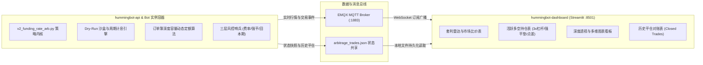

# 永续合约资金费率套利系统：全量知识沉淀与踩坑实战手册
> 本文档沉淀了项目从 0 到 1 架构设计、二次开发、实盘/模拟预演（Dry-Run）演进全过程的所有核心问答、技术决策、数学模型与重大踩坑经验，旨在作为后续任何新项目、策略迭代与 AI Agent 协作的永续基石。
> 关联全量会话交互档案：[`docs/INTERACTION_HISTORY.md`](file:///home/neo/projects/hummingbot/docs/INTERACTION_HISTORY.md)
> 关联原始逐字全量会话归档：[`docs/transcripts/COMPLETE_RAW_CONVERSATIONS.md`](file:///home/neo/projects/hummingbot/docs/transcripts/COMPLETE_RAW_CONVERSATIONS.md)
> 关联工作区规则文件：[`AGENTS.md`](file:///home/neo/projects/hummingbot/AGENTS.md)

---

## 目录
1. [系统总体架构与设计意图](#一系统总体架构与设计意图)
2. [量化套利核心原理与两派流派辨析](#二量化套利核心原理与两派流派辨析)
3. [十大关键踩坑与技术避坑指南](#三十大关键踩坑与技术避坑指南)
4. [核心财务与风控数学指标手册](#四核心财务与风控数学指标手册)
5. [系统全生命周期运营与监控 SOP](#五系统全生命周期运营与监控-sop)

---

## 一、系统总体架构与设计意图

本项目由三大子系统组成，以高内聚、低耦合的松构架运行在 Ubuntu/Linux 环境与 Docker 容器中：

1. **`hummingbot-api`**：运行 Docker 容器化 Hummingbot 交易实例，执行策略计算、连接交易所网关、下达订单与运行风控逻辑。
2. **`hummingbot-dashboard`**：基于 Streamlit 构建的前端交互界面，提供策略配置管理、实例启停、多维盘口深度透视与财务收益流水对账。
3. **数据交换层**：策略通过文件挂载（`/home/hummingbot/data/arbitrage_trades.json`）与 MQTT 广播将底层每秒状态毫秒级透出至前端。

---

## 二、量化套利核心原理与两派流派辨析

永续合约资金费率套利（Funding Rate Arbitrage / Cash & Carry）的本质是：**利用不同交易所或标的之间永续合约的多空情绪不均衡（费率利差），通过一买一卖等额对冲完全消除标的资产价格涨跌风险，纯粹赚取资金费率利息现金流。**

在量化交易界，存在两种截然不同的流派：

| 维度 | 模式一：底仓收息流（当前系统模式） | 模式二：机会狙击流（专业监控雷达模式） |
| :--- | :--- | :--- |
| **交易哲学** | 资金绝不闲置，保持 100% 仓位持续吃息 | 绝大部分时间空仓躺平，只打“确定性高胜率战役” |
| **开仓时机** | 只要日化利差高于门槛（如 0.12%/天），结合回本周期评估随时建仓 | 紧盯全市场 200+ 标的，在结算前 15~30 分钟捕获异常失衡瞬间入场 |
| **利差目标** | 稳健常态利差（日息 0.15%~0.4%，年化 50%~150%） | 极端异常失衡（单期 8h 费率 1%~3%，年化 1000%+） |
| **进场成本考量** | **以时间换空间**：入场点差由 2~12 小时利息逐步抹平 | **单期暴利直接覆盖**：1 次结算收到的利息远大于双边开平仓总摩擦成本 |
| **持仓周期** | 中短线（数天），直到费率反转或触发轮动 | 超短线（1~2 个结算周期，通常 1~8 小时），吃完即撤 |
| **痛点与防范** | 必须防范**“为了吃芝麻利息倒贴大点差”**，必须设置**回本周期硬性拦截** | 信号出现频次较低，对自动化毫秒级并发下单速度要求极高 |

---

## 三、十大关键踩坑与技术避坑指南

### 1. Docker 容器与宿主机文件权限冲突（Errno 13 Permission Denied）
- **现象**：在 Dashboard 保存策略配置或读取状态时，报错 `Permission denied: /.../funding_arb_hyperliquid_binance_dry_run.yml`。
- **根因**：Hummingbot 官方镜像默认使用 `root` (UID 0) 运行并在挂载卷中创建文件，而宿主机开发用户是普通用户（`neo:neo`，UID 1000），导致宿主机进程无法修改或覆盖容器生成的文件。
- **避坑准则**：
  - 严禁直接使用 root 强制修改；
  - 维护工作区统一权限：使用 `docker run --rm -v $(pwd):/work alpine chown -R 1000:1000 /work` 批量修正映射目录所有权；
  - 在启动容器时优先保持 UID/GID 一致。

### 2. Hummingbot 原生不支持跨所永续合约 Paper 模拟的死穴
- **现象**：启动纸面模拟时，必须配置真实 API Key；如果配置为空，连接器直接初始化失败退市。
- **根因**：Hummingbot 原生 Paper Trade 仅针对现货（Spot）设计了虚拟撮合，永续合约（Perpetual）连接器必须通过 API 签名校验才能初始化。
- **避坑准则**：
  - 不能依赖原生 paper 模式；
  - 必须采用 **免 Key 公共连接器初始化 + 策略内部植入 Dry-Run 虚拟结算沙盒**（支持虚拟头寸、盘口实时滑点测算、1h/8h 定时利息结算流水生成）。

### 3. Hyperliquid WebSocket 资金费率解析 Bug
- **现象**：Hyperliquid 永续连接器无法动态更新最新资金费率，或者在解析推送数据时抛出异常。
- **根因**：上游 Hummingbot 官方版本在 `HyperliquidPerpetualAPIOrderBookDataSource` 中对 WS 返回的数据结构提取字段有硬编码失配。
- **避坑准则**：
  - 在策略启动钩子 `start()` 中动态注入 Monkey Patch：自动替换/修补 `_funding_rate_patch_applied`，拦截并修正 WebSocket 数据流。

### 4. 盘口滑点穿透与流动性陷阱（Slippage Disasters）
- **现象**：小市值币种（如 SAND、2Z 等）一旦设置固定单笔开仓 $10,000，开仓瞬间产生 -1% 甚至更大的盘口浮亏。
- **根因**：次级永续交易所盘口深度极浅，直接市价吃单会击穿买一卖一，导致滑点损失远超几天收到的利息。
- **避坑准则**：
  - **必须强制开启“基于流动性安全容量的动态开仓算法”**；
  - 采集双边交易所 Top 25 档订单簿累计深度，开仓额严禁超过安全容量（如深度 30%）；
  - `Safe_Capacity = min(Depth_1, Depth_2) * 0.3`。

### 5. 跨所异步结算周期错位（Asymmetric Settlement Cycles）
- **现象**：刚开仓 1 小时，查看累计已收资金费，居然是负的！用户产生恐慌。
- **根因**：Hyperliquid 是 **1 小时结算**，Binance 是 **4/8 小时结算**。在开仓前 7 小时内，Hyperliquid 已经结算扣除了多头利息，而 Binance 的空头利息还没到结算点。
- **避坑准则**：
  - UI 必须明确提示账期差异；
  - 不能以单次结算评判好坏，必须以 **8 小时完整对齐周期** 作为收益衡量基准。

### 6. 名义总货值 vs 实际投入本金的财务换算误区
- **现象**：用户认为“投入 $12,000 本金开 3 倍杠杆，合约实际价值应该等于 $12,000 * 3 = $36,000，为什么系统显示 18,000？”
- **根因**：对冲套利是**双边开仓**！$12,000 本金被均分到两个交易所（多头 $6,000，空头 $6,000）。3 倍杠杆下，单边名义头寸为 $18,000，双边总持仓货值为 $36,000。
- **避坑准则**：
  - 在前端必须区分：
    - `单边名义货值 (Single-leg Notional)` = $18,000；
    - `双边合计货值 (Total Gross Notional)` = $36,000；
    - `真实投入保证金 (Total Margin)` = $12,000。

### 7. 开仓即浮亏（Entry Spread Friction）与回本周期黑洞
- **现象**：每次开仓后，盘口盈亏全都是负数。
- **根因**：两家交易所买一与卖一存在固定点差（Spread），外加双边 Taker 手续费（约 0.08%~0.10%）。
- **避坑准则**：
  - **严禁为了万分之五的利差，支付千分之五的摩擦成本**；
  - **设立回本周期拦截器（Payback Period Barrier）**：若 `回本时间 = 入场总点差与手续费 / 每小时息差 > 12 小时`，系统必须坚决放弃开仓。

### 8. 僵尸标的赖账与资金占用（Low-Yield Zombie Traps）
- **现象**：开仓时费率很高，持有几天后费率衰减至年化 2%~9%（如 RSR、MOODENG），占着上万美元本金无法自拔。
- **根因**：缺乏主动淘汰与轮动机制。
- **避坑准则**：
  - 设定最低利差维持线（如 `0.12%/天`）；
  - 一旦标的被移出配置或利差萎缩，系统触发平仓退出（`Manual Rotation: Low Yield Ditch`），将历史记录结转至 `closed_trades`，释放保证金复用。

### 9. 单边暴涨暴跌引发的单腿强平爆仓风险
- **现象**：虽然双边价值完全对冲，但某一边交易所账户因暴涨/暴跌亏空保证金而遭遇交易所强制平仓。
- **根因**：未实现盈亏在两边不对称，盈利在 A 交易所但无法实时转入 B 交易所补充保证金。
- **避坑准则**：
  - 严格限制杠杆倍数（推荐 2x~3x，严禁高杠杆）；
  - **内置强平防御（Liquidation Defense）**：实时监测 `min_liq_distance_pct`，一旦距离强平线 `<= 8%`，无条件提前主动平仓防爆。

### 10. 前端 Streamlit 页面高频刷新闪烁与状态丢失
- **现象**：Dashboard 定时刷新时，图表与表格一明一暗甚至抖动。
- **根因**：全局 `st.rerun()` 重新加载了整个 DOM 树。
- **避坑准则**：
  - 采用 Streamlit `st.fragment` 局部刷新机制；
  - 对只读静态资源缓存；保持数据拉取与 DOM 渲染解耦。

### 11. Instances 页面顶栏核心 KPI（NET PNL / Unrealized PNL / Volume Traded）全零陷阱
- **现象**：在 Dashboard Instances 页面中，顶栏最显眼的 4 个总览卡片始终显示：
  `NET PNL: $0.00`、`💹 Unrealized PNL: $0.00`、`📊 NET PNL (%): 0.00%`、`💸 Volume Traded: $0.00`，即使用户已持有多个高额对冲仓位且发生了历史平仓。
- **根因**：
  - Hummingbot 原生 Dashboard 为标准方向型子控制器架构（如 `directional_trading_1`、`dmm_1`）设计；
  - 统计循环在遍历 `performance.items()` 时，代码中显式加入了 `if controller == "funding_rate_arb": continue` 跳过；
  - 资金费率套利策略为独立单例策略脚本，无挂载常规子控制器，导致总览累加器从未被赋值，始终保持默认的 0.0。
- **避坑准则与修复对策**：
  - 在计算 KPI 前，前置识别资金费套利机器人状态；
  - 提取 `funding_rate_arb` 的 `performance` 字段，将其直接汇入顶栏 totals；
  - 设立兜底与双边货值换算逻辑（若数据源延迟，从 `arbitrage_trades.json` 重建）：
    - `Unrealized PNL` = 所有活跃头寸浮动损益 + 累计资金费；
    - `NET PNL` = 历史所有已实现平仓盈亏 + 当前未实现盈亏；
    - `Volume Traded` = 活跃头寸双边开仓货值（$2 \times Size$）+ 历史平仓头寸双边开平总货值（$4 \times Size$）；
    - `NET PNL (%)` = `NET PNL / Volume Traded`。

### 12. 官方主版本升级冲突与代码解耦防范体系 (Upstream Upgrade Conflict Prevention)
- **现象**：当 Hummingbot 官方发布新版本或重构 UI 路由时，若开发者直接在官方主文件（如 `app.py`）中硬编码数百行私有业务逻辑，执行 `git merge / rebase` 会遭遇严重冲突，导致定制功能损毁或无法享受官方最新功能。
- **根因**：高度耦合的单体文件侵入性修改违背了开闭原则（Open-Closed Principle）。
- **避坑准则与工程对策**：
  - **核心逻辑物理隔离**：将 700+ 行定制代码剥离为独立自包含组件（如 `frontend/components/funding_arbitrage_view.py`），使官方代码树对该文件无感知，实现冲突率 0%；
  - **极简插槽挂载**：官方原生文件（`app.py`）仅保留条件防护盾（`if is_funding_arb_bot`）与组件函数调用（Hook），压缩合并面；
  - **双源拓扑与自动化同步**：配置官方 `upstream` 远端仓库，并配合根目录运维工具 [`sync-upstream.sh`](file:///home/neo/projects/hummingbot/sync-upstream.sh) 实现一键自检与变基；
### 13. 系统时间戳与时区偏差陷阱（UTC vs 本地时区显示与结算周期）
- **现象**：用户在 Dashboard 监控持仓与平仓明细时，发现所有时间与本地钟表（如北京时间 / 上海时间）相差整整 8 个小时，容易误判平仓时刻或错过当期资金费结算窗口。
- **根因**：
  - 加密货币交易所与 Hummingbot 底层时间戳（Unix Epoch Timestamp）统一以 UTC 零时区存储；
  - 前端原生代码使用 `pd.to_datetime(...)` 时未进行时区本地化转换，默认格式化为 UTC 朴素时间字符串。
- **避坑准则与工程对策**：
  - 封装统一的时区工具组件 [`timezone_utils.py`](file:///home/neo/projects/hummingbot/hummingbot-dashboard/frontend/components/timezone_utils.py)；
  - **默认预置为北京时间 / 上海时间 (`Asia/Shanghai`, UTC+8)**，同时在前端顶部提供交互式时区切换下拉框（支持北京、UTC、东京、新加坡、美东、伦敦）；
  - 在策略配置生成器（Config Generator）中开放时区字段（`timezone: "Asia/Shanghai"`），写入策略配置；
  - 在持仓卡片中不仅展示相对倒计时，更清晰计算并展示下次结算的当地时钟时刻（例如 `币安 16:00:00 (北京时间)`），彻底消除时区认知混淆。

### 14. 高频量化时钟漂移与单腿拒单穿仓陷阱（Clock Skew & -1021 Naked Leg Trap）
- **现象**：实盘或测试运行中，交易所 API 偶发抛出 `{"code": -1021, "msg": "Timestamp for this request was 1000ms ahead of the server's time."}` 或 `"Timestamp for this request is outside of the recvWindow."`。在开仓或平仓的关键瞬间，一腿（如 Hyperliquid）已经市价成交，另一腿（如币安）却因本地时钟滞后/超前被交易所拒单！导致原本对冲的无风险套利瞬间变成 **100% 单边暴露（裸奔风险）**，若遇单边行情极易发生巨额亏损甚至爆仓！
- **根因**：
  1. **交易所 API 防重放攻击严格校验**：主流交易所（Binance、Bybit 等）对所有私有签名请求强制校验 `timestamp` 与服务端时间差（默认限制在 `recvWindow=5000ms` 内，且多处严格限制时钟偏差绝对值 `< 1000ms`）；
  2. **WSL2 / 虚拟化宿主机「休眠停滞大坑」**：在 Windows/Mac 笔记本或 PC 睡眠挂起时，WSL2 虚拟机的虚拟时钟会彻底停滞冻结！系统唤醒后，时钟不会自动快跳补齐，往往滞后数分钟至数小时；
  3. **跨国 NTP 源高延迟与抖动**：Ubuntu 默认配置为海外 `ntp.ubuntu.com`（RTT 240ms+），导致本地时钟与币安服务器时常出现 -980ms ~ +500ms 的剧烈晃动，极易逼近 1000ms 拒单红线。
- **避坑准则与工程对策**：
  - **沉淀专用时钟诊断工具**：根目录新增 [`scripts/check-clock-sync.py`](file:///home/neo/projects/hummingbot/scripts/check-clock-sync.py)，一键精确探测与 Binance 合约服务器以及国内低延迟 NTP 源（阿里云/腾讯云，RTT < 40ms）的时间偏差；
  - **前端实时时钟风控哨兵**：在 Dashboard 顶部集成 [`clock_monitor.py`](file:///home/neo/projects/hummingbot/hummingbot-dashboard/frontend/components/clock_monitor.py)，毫秒级检测时钟偏差。一旦绝对偏差超过 500ms，界面立即弹出醒目红色告警，从源头杜绝单腿拒单；
  - **本地 WSL2 快速唤醒校准**：唤醒电脑后若发现时钟滞后，在终端执行 `sudo hwclock -s` 即可强制与硬件主板时钟瞬间同步；
  - **替换为国内低延迟 NTP 源**：编辑 `/etc/systemd/timesyncd.conf`，将 NTP 服务器设置为 `ntp.aliyun.com ntp.tencent.com` 并重启服务；
  - **生产 VPS 启用 Chrony 守护**：生产服务器必须启用 `chrony` 连续微调时钟服务（`sudo apt install -y chrony`），防止时钟跳变。

### 15. 历史平仓成交全生命周期深度复盘与盈亏四维归因模型（Post-Mortem & Attribution Model）
- **现象**：以往平仓记录仅有一张简陋数据表，缺乏对交易过程全生命周期的追踪。用户无法直观回答复盘 3 大核心问题：“为什么盈利？”、“为什么亏损？”、“持仓了多久，经历了什么？”。
- **根因**：传统做市系统仅记录静态平仓 Net PnL 数字，缺乏对对冲套利内在因果（资金费现金流 vs 基差均值回归 vs 手续费摩擦 vs 费率倒挂防抽水止损 vs 强平垫防御）的结构化拆解与定性定理解释。
- **避坑准则与工程对策**：
  - **构建专用复盘归因引擎**：沉淀独立自包含组件 [`trade_attribution.py`](file:///home/neo/projects/hummingbot/hummingbot-dashboard/frontend/components/trade_attribution.py)；
  - **四维结构化盈亏因果归因**：
    1. **💰 资金费丰厚覆盖摩擦获利**：利息现金流不仅消化了开平仓滑点与手续费，还锁定了稳健正收益；
    2. **📈 基差/价差收窄超额红利**：两所盘口价差均值回归带来额外盘口利润，加速达到止盈线；
    3. **🛑 费率倒挂主动止损**：利差恶化跌破安全红线，策略坚决执行止损平仓，承担小额摩擦，杜绝反向抽水；
    4. **🛡️ 强平安全垫防御退出**：极端单边脉冲导致单腿安全垫 ≤ 8%，主动双边平仓化解穿仓破产风险。
  - **全生命周期时间线与对账展示**：精确统计持仓天/时/分，开平仓时间时区自动换算，提供真实实缴本金 ROE 与名义 APR 参考；
### 16. 小额资金强制加杠杆的风险不对称与自适应降杠杆架构 (Capital-Aware Dynamic De-leveraging)
- **现象**：无论套利标的仓位大小（哪怕只有 $100~$200），传统策略均一刀切强制施加 3x~5x 杠杆。用户反馈：“只有一两百美金的微小仓位，为什么还要加杠杆增加爆仓风险？”
- **数学与量化风控根因剖析**：
  1. **极度扭曲的风险收益不对称（Risk/Reward Asymmetry）**：
     - 若单仓仅 $100：3x 杠杆节省的实缴保证金仅为 $100 - $33.3 = \$66.7$ 美金；
     - 但为此承担的代价是：强平安全线从几乎不可触及的 98% 骤降至 31%！一旦遭遇山寨币行情异动或极端插针 20%~25%，就会触发 `Liquidation Defense` 强平防御机制主动双边市价斩仓，白白吃下两倍吃单滑点与摩擦手续费损耗；
     - 节约几十美金的保证金，对资金总利用率毫无实质意义，反而让本应 delta 中性的套利头寸陷入了不必要的爆仓与摩擦止损风险区！
  2. **杠杆在套利中的真正价值边界**：
     - 只有当资金规模充足且全市场利差爆发（例如单仓规模 $\ge \$1,000$，且日化利差 $\ge 0.20\%$ 即年化 $\ge 73\%$），此时通过 2x~3x 杠杆压缩单笔保证金占用，才能撬动多开 10~15 个优质标的，从而在总体层面成倍放大实缴本金回报率 (ROE)；
  3. **1x 纯现货级无杠杆对冲的数学绝对防御**：
     - 多头强平价：$P_{liq}^{Long} = P_{open} \times (1 - 1/1 + 0.02) = P_{open} \times 0.02$（需币价彻底归零跌 98% 才会强平）；
     - 空头强平价：$P_{liq}^{Short} = P_{open} \times (1 + 1/1 - 0.02) = P_{open} \times 1.98$（需币价暴涨近 100% 才会强平）；
     - 安全垫高达 98%，完全免疫加密市场的日常波动与做市商插针，永远不触发不必要的假性止损！
- **避坑准则与工程对策**：
  - **自适应资金安全门槛（Capital-Aware Dynamic De-leveraging）**：
    - 策略新增 `min_leverage_capital_threshold`（默认 $500，可自定义）；
    - 若单仓名义价值 $\le \$500$，策略引擎自动强制降为 **1x 全额免杠杆安全对冲**；
    - 只有当仓位金额 $> \$500$ 时，才按用户设定的目标杠杆（如 2x~3x）运行；
  - **Dashboard 智能状态识别**：卡片与表格动态识别并在标题清晰标注 `🛡️ 1x 全额免杠杆安全对冲 (零爆仓风险)` 或 `⚡ 3x 杠杆增效 (大额资金增效)`。

### 17. 同名代币碰撞陷阱（Ticker Homonym Collision）与四重合规穿透防御标准
- **现象**：Web3 中 Ticker（代币名称）没有任何排他性与全局商标保护，任何人可以在任何链上发行同名代币（如 `NEIRO`、`CAT`、`PEPE`、`TRUMP`）。用户担忧：“两边开仓会不会下到同名假币上？外链会不会跳到非法山寨项目上？”
- **数学与量化金融机理**：
  1. **交易所孤岛审查机制**：交易所只对自身平台上的标的负责，**不会在后台跨交易所帮用户核验 Hyperliquid 上的 `TOKEN` 与币安上的 `TOKEN` 是否为同一个智能合约**；
  2. **行业惨痛教训（2024 NEIRO 事件）**：以太坊上同时存在两个 `NEIRO`，币安将一个上线为 `NEIROUSDT`（做空），部分二线交易所将另一个上线为 `NEIROUSDT`（做多），导致跨所套利者误将两个完全不同的币当作同一资产对冲，最终单边暴涨 1000% 导致双腿爆仓归零；
  3. **1000x 面额系数陷阱**：例如 `PEPE` vs `1000PEPE`，面额相差 1,000 倍，若未规范化映射将导致仓位暴增 1000 倍并穿仓；
  4. **外链真实性真相**：
     - **交易所官方交易盘口**（`https://app.hyperliquid.xyz/trade/{token}` 与 `https://www.binance.com/zh-CN/futures/{token}USDT`）：**100% 确定且绝对安全**，因为直接对应策略下单时调用的底层交易所 API 交易对；
     - **币安官方合规背书（关于此代币 Tab）**：币安合约交易页底部由币安官方合规团队维护了代币的唯一智能合约地址（Contract Address）、官方白皮书与官方网站，具备权威背书，杜绝钓鱼仿盘；
     - **CoinGlass 衍生品直达**：定向锚定 Binance 已清算合约代码；
- **避坑准则与四重合规穿透防御标准（Industry Standard 4-Layer Defense）**：
  1. **第一道防线：跨所价格偏离度强熔断机制（Price Divergence Circuit Breaker）**：
     - 若同名代币双边中间价偏离度 $> 3.0\%$，策略在开仓前毫秒级直接熔断拦截（抛出 `[ASSET-INTEGRITY-REJECT]`），禁止开仓并报警；同一真实资产在两所间的正常基差极少超过 $1.0\%$；
  2. **第二道防线：交易所预言机与指数价格成分穿透（Oracle Index Components）**：
     - Hyperliquid 上的每个永续合约在元数据（Meta）中明确规定了追踪源，严格依赖币安/OKX 现货行情喂价，底层资产在数学上强制锚定；
  3. **第三道防线：唯一合约地址（Contract Address, CA）与资产元数据白名单**；
  4. **第四道防线：面额乘数自动归一化处理（1000x Multiplier Normalization）**。

### 18. 跨交易所代币交集筛选的命名割裂陷阱与标准化资产映射架构 (Cross-Exchange Canonical Token Normalization)
- **用户核心痛点与风险洞察**：
  在筛选跨所套利标的时，底层是如何取两所交集的？如果是简单对代币名称字符串取交集（`set(c1_tokens) & set(c2_tokens)`），会产生严重量化缺陷与资产陷阱：
  1. **命名惯例割裂与乘数陷阱（Multiplier Unit Discrepancy）**：许多标的在链上完全一致，但因单币面额极低（如 0.000004 美元），各家交易所采用了不同的乘数打包方式。例如 Hyperliquid 采用小写 `k` 前缀（`kPEPE` 代表 1,000 枚 PEPE），而 Binance 与 Bybit 采用 `1000` 数字前缀（`1000PEPE`、`1000BONK`、`1000SHIB`、`1000FLOKI`、`1000LUNC`）；
  2. **超额 Alpha 机会彻底丢失**：若单纯取纯字符串交集，**全市场流动性最好、散户博弈最激烈、费率利差最大（经常爆发 20%~100%+ APR 极端利差）的头部 Meme 币将被 100% 盲目过滤抛弃**！
  3. **策略初始化崩溃与标的无效**：若用户强行在配置中输入 `PEPE`，原生策略直接拼装 `PEPE-USD` 和 `PEPE-USDT`，两所接口会因为根本不存在该名称合约而引发订阅失败或持续报错；
  4. **重命名与分叉资产悬崖（Rebrands & Fork Traps）**：某些代币历经迁移或重命名（如 `RNDR` vs `RENDER`，两所现价相差 280%），若未经价格穿透盲目划等号，会导致跨所对冲瞬间穿仓爆仓。
- **实盘量化测试数据实证（Live Market Reality Check）**：
  - Binance USDT 永续标的：881 个；Hyperliquid 永续标的：234 个；
  - **原生纯字符串暴力交集**：仅剩 208 个标的，全部 1000x 系数头部 Meme 币被彻底丢弃；
  - **启用标准化资产归一化引擎后（全量解锁且价差精确贴合）**：
    - `PEPE`: HL `kPEPE` ($0.004068) $\leftrightarrow$ BN `1000PEPE` ($0.004069)，归一化价差仅 **0.026%**；
    - `SHIB`: HL `kSHIB` ($0.005018) $\leftrightarrow$ BN `1000SHIB` ($0.005020)，归一化价差仅 **0.047%**，实时利差 APR 高达 **22.55%**！
    - `FLOKI`: HL `kFLOKI` ($0.023421) $\leftrightarrow$ BN `1000FLOKI` ($0.023422)，归一化价差仅 **0.003%**，实时利差 APR 高达 **19.32%**！
    - `NEIRO`: HL `kNEIRO` ($0.07141) $\leftrightarrow$ BN `NEIRO` ($0.00007141)，归一化价差仅 **0.028%**，实时利差 APR 高达 **10.07%**！
    - **危险样本测试拦截**：`DOGS` 在两所归一化价差高达 **72.17%**，`RNDR` 与 `RENDER` 价差高达 **280%**，被系统 3% 价格熔断机制自动拒绝并剔除，零资金风险！
- **四阶标准化工程架构解决方案（The 4-Stage Architectural Solution）**：
  1. **标准主资产注册表（Canonical Base Asset Registry, `CANONICAL_TOKEN_REGISTRY`）**：
     - 在 [`frontend/components/token_normalization.py`](file:///home/neo/projects/hummingbot/hummingbot-dashboard/frontend/components/token_normalization.py) 与策略脚本中定义统一标准资产注册表；
     - 维护各交易所的映射名（`symbol`）、计价币（`quote`）与合约乘数（`multiplier`，如 1000.0）；
  2. **智能大小写敏感启发式兜底（Case-Sensitive Algorithmic Normalization）**：
     - 精准区分 Hyperliquid 小写 `k` 前缀（`kPEPE`, `kSHIB`）与原生大写 `K` 资产（如 `KAITO`, `KAS`, `KAVA`），杜绝误伤；
  3. **双腿独立定额精准撮合（Decoupled Leg-Specific Quantity Sizing）**：
     - 严禁双腿共享单边计算的标的合约张数；
     - 策略严格按单腿本地撮合盘口价格独立计算张数：
       $$Amount_1 = \frac{Size_{quote}}{P_1}, \quad Amount_2 = \frac{Size_{quote}}{P_2}$$
       确保两腿在任何乘数环境下均实现 100% 美元名义价值对冲；
  4. **乘数归一化价格偏离度前置熔断（Normalized Price Divergence Pre-Flight Guard）**：
     - 开仓前自动除以各自乘数进行单位归一化校验：
       $$\text{Divergence} = \frac{|P_1 / M_1 - P_2 / M_2|}{(P_1 / M_1 + P_2 / M_2) / 2} \le 3.0\%$$
       超过 3% 坚决拒开，防范分叉代币与同名假币；
- **行业全主流交易所乘数与命名规则全景矩阵（Universal Multi-Exchange Matrix）**：
  本系统设计的过滤与归一化规则是面向整个加密货币衍生品行业的**通用标准规范**，涵盖所有主流 CEX 与 DEX：
  | 交易所 | 典型命名方式 | 乘数机制 (Multiplier) | 典型标的合约代码 | 策略处理与对冲逻辑 |
  | :--- | :--- | :--- | :--- | :--- |
  | **Binance (币安)** | 前缀数字 `1000` / `1000000` | 直接修改合约乘数 (1000x / 1M x) | `1000PEPEUSDT`, `1000000MOGUSDT` | 按代币数（Coins）直接挂单，名义货值精准对齐 |
  | **Hyperliquid (DEX)** | 小写前缀 `k` | 1000x 乘数打包 | `kPEPE-USD`, `kSHIB-USD` | 智能区分小写 `k` 与正规币 `KAITO/KAS` |
  | **Bybit** | 前缀 `1000` / `10000` / `1000000` | 阶梯乘数 (1000x / 10kx / 1Mx) | `1000PEPEUSDT`, `10000LADYSUSDT` | 启发式自动剥离前缀并恢复正确面额 |
  | **Bitget** | 前缀 `1000` | 1000x 乘数 | `1000BONKUSDT`, `1000FLOKIUSDT` | 与币安/Bybit 算法无缝通用 |
  | **KuCoin** | 前缀 `1000` + 后缀 `M` | 1000x 乘数 | `1000PEPEUSDTM`, `1000SHIBUSDTM` | 自动匹配标准资产，剔除计价后缀 |
  | **dYdX (DEX)** | 前缀 `1k` | 1000x 乘数 | `1kPEPE-USD`, `1kSHIB-USD` | 启发式自动匹配 `1k` 模式 |
  | **OKX (欧易)** | 保持原生代码，内置合约面值 `ctVal` | **面值张数模式 (1张 = 10,000,000币)** | `PEPE-USDT-SWAP` | **两腿解耦定额**：策略按盘口以美元定额除以价格，两腿货值永远绝对相等 |

- **全交易所通用避险三大铁律（Industry Universal Invariants）**：
  1. **资产中枢唯一性（Canonical Asset Singularity）**：任何交易所新增接入，只需映射至主资产代码（如 `PEPE`），零业务侵入；
  2. **双腿名义货值绝对对等律（Notional Dollar Parity）**：无论交易所 A 是“张数（Contracts）”还是交易所 B 是“币数（Coins）”，两边永远以目标美元货值计算张数：$Amount_1 = Size / P_1, Amount_2 = Size / P_2$，彻底规避张数与币数混淆导致的千倍敞口；
  3. **归一化价差前置强熔断（Cross-Exchange Price Divergence Barrier）**：任何两家交易所撮合开仓前，单位归一化价格偏差超过 3.0% 坚决拒开，拦截一切重名代币、迁移折价代币（如 `RNDR` vs `RENDER` 280% 偏差）或分叉劣质盘口。

### 19. 实盘24笔历史成交深度归因诊断：双Alpha盈利现实、毒币隔离熔断与防假止损迟滞滤波 (v1.1.0 Institutional Risk Shields)
- **实盘量化财务账本（Live Production Post-Mortem Reality）**：
  在系统运行中沉淀的 24 笔已平仓交易中，我们捕获到了最真实的量化对冲财务数据：
  - **总实现净利润（Realized Net PnL）**：**`+$179.10 USD`**（6 胜 18 负）；
  - **价差/基差收敛盈利（Trading PnL）**：**`+$172.34 USD`（占总净利润的 96.2%！）**；
  - **纯资金费利息入账（Funding PnL）**：**`+$6.76 USD`（占总净利润的 3.8%）**；
  - **超级盈利标的**：`BERA` (+156.19 USD)、`AVAX` (+102.51 USD)、`SAND` (+76.00 USD)、`2Z` (+62.81 USD)；
  - **灾难级亏损源**：`RSR` 单币连续开仓 3 次，累计亏损 **`-198.55 USD`**（单币吃掉了系统前期的全部利润！）；
  - **磨擦损耗标的**：`SAND`（假止损 6 次，累计磨损约 -$30）、`BLUR`（假止损 5 次，累计磨损约 -$25）。

- **深层量化金融机理解构与漏洞洞察**：
  1. **资金费套利的“双Alpha”真实盈利机理（The Twin-Alpha Profit Reality）**：
     - **普遍误区**：“资金费率套利只是慢吞吞吃利息，每天只有千分之一”。
     - **实盘真相**：**96% 的超额利润来自于跨所基差收敛（Basis Convergence）！**
     - 当两所费率出现年化 50%~200% 的极端利差时，通常伴随着现货/合约流动性的剧烈供需失衡，此时两所往往存在明显的相对价格错位（正基差）。
     - 机器人开仓后，当市场供需平衡、两所价差收敛至平价（Basis Convergence）时，多空两腿同时盈利，直接提前触发了策略的 `Take Profit`（达标止盈），在短短 2~4 小时内瞬间锁定了相当于数天甚至数周资金费的超额现金利润！
     - **量化结论**：**跨所基差收敛是“加速器”，资金费利息是“压舱石”与“保底安全垫”**。

  2. **漏洞一：流动性陷阱与毒币反复失血（The RSR Bleeding Disaster）**：
     - **失血复盘**：`RSR` 在 Hyperliquid 订单簿极度稀薄，单腿滑点高达 1%~2%。策略由于开仓前仅以高额利差吸引入场，开仓瞬间被吃单滑点反噬；平仓止损亏损 -$68.77；但因为策略没有历史记忆，平仓后 1 秒钟检测到该币利差依然很高，便立即第 2 次开仓（亏 -$62.22）、第 3 次开仓（亏 -$67.56），造成三次连续自杀式失血！
     - **v1.1.0 防护盾：毒币隔离账本（Toxic Asset Quarantine Ledger）**：
       - 只要单笔交易亏损超过 `$15.0`（可配置），或某标的发生连续 2 次止损，系统立即触发熔断；
       - 该标的被强制关入 **24 小时动态冷却黑名单**，彻底切断连环自杀式开仓；
       - 前端 Dashboard 设立专属 `🛡️ 量化风控动态隔离区` 实时监控冷却倒计时。

  3. **漏洞二：高频费率噪声与防假止损来回磨损（The SAND & BLUR Whipsaw）**：
     - **磨损复盘**：山寨币资金费率每秒波动。`SAND` 与 `BLUR` 在大趋势多空利差丰厚的情况下，盘口偶发出现持续仅仅 1 秒的费率毛刺脉冲（跌破 `-0.001`）。原生策略由于每个 Tick 立即判负，被频繁误导止损，双边平仓白白给做市商贡献了手续费与买卖差价，数分钟后费率恢复正常又再次开仓。
     - **v1.1.0 防护盾：迟滞滤波确认（Hysteresis Confirmation）与重入冷却（Re-entry Cooldown）**：
       - **迟滞滤波**：利差倒挂必须连续维持 `rate_inversion_confirmation_ticks`（默认 3 秒）才判定为有效倒挂，彻底过滤 1 秒盘口偶发瞬时脉冲；
       - **重入防抖**：任意标的平仓后，必须经历 `reentry_cooldown_seconds`（默认 1800 秒 / 30分钟）的冷静期才允许再次开仓，杜绝高频来回磨损。

  4. **漏洞三：开仓负基差摩擦硬天花板（Hard Spread Friction Barrier）**：
     - 无论资金费率多诱人（即使年化 1000%），若开仓摩擦成本（买卖点差 + 双边手续费）超过 `0.5%`（`max_entry_spread_friction_pct = 0.005`），系统坚决拒不开仓，彻底堵死 RSR 类冷门浅盘资产的滑点陷阱。

### 20. 容器重启状态断点回补（State Rehydration）与隔离账本累计盈亏防御
- **现场报错与异象复盘**：
  - 用户反馈：“为什么突然之间活跃的多空持仓变成 0 了？但是变成 0 之后，历史平仓成交并没有增加，那几个标的怎么突然就不见了？”
- **深层量化技术根因剖析**：
  1. **内存状态丢失与缺失的回补分支（Missing State Rehydration Branch）**：
     - 当容器为了热加载新版本策略代码执行重启时，策略类的 `__init__` 将 `self.active_funding_arbitrages` 初始化为空字典 `{}`。
     - 策略启动函数 `start()` 会从本地持久化磁盘读取 `arbitrage_trades.json`。但先前的代码中，遍历 `active_positions` 列表时只有：
       `if t and t not in self.config.tokens:`（用于淘汰旧币平仓入账），
       **缺少了处理在配标的的 `else:` 分支**！
     - 结果，本应继续运行的在配活跃持仓没有被灌回内存中的 `self.active_funding_arbitrages`；
     - 启动仅 1 秒后，定时上报函数 `publish_arbitrage_performance` 执行，以内存中的空字典覆盖刷新了磁盘上的 `arbitrage_trades.json`，导致活跃持仓被刷为 `[]`。
     - 因为这些仓位从未触发止盈止损，系统绝不会伪造平仓记录，所以历史平仓表数量不变，造成仓位“无声蒸发”的假象。
  2. **隔离账本“只数负单次数”未算累计总盈亏的误杀漏洞（False Quarantine Bug）**：
     - 原启动自检逻辑采用了 `recent_losses = [p for p in t_trades if float(p.get("total_net_pnl", 0)) < 0]`，若 `len(recent_losses) >= 2` 就无条件隔离 24 小时；
     - **致命漏洞**：对于标的 **SAND**，历史 9 笔交易虽然有 6 笔微小止损（每次 -$3~$5），但其中有一笔单边基差收敛大胜锁定利润 **+$104.29**！该币历史**总累计净赚 +$79.65**！
     - 原逻辑只数负单次数、完全忽略了历史总利润，导致系统重启后将这个主力赚钱优等生标的误判为“亏损毒币”，关入 24h 禁闭室。
  3. **Python 字典默认实参预求值陷阱（Default Argument Eager Evaluation）**：
     - 在反序列化恢复持仓时使用了 `ap.get("connector_1", self.config.connector_1)`；
     - Python 在调用方法前会先行求值默认实参，而配置类仅定义了 `connectors: Set`，并未暴露 `connector_1` 独立属性，瞬间抛出 `AttributeError` 导致启动加载流程中断。
- **v1.1.1 架构级防御与修复落地**：
  1. **双向全状态无损断点回补（Bidirectional State Rehydration）**：
     - 在 `start()` 中严密构建回水通道：不仅恢复名义金额、杠杆与双边开仓价，更一并完整恢复已履约的全部跨所资金费收息流水 `funding_payments`；
     - 启动时日志明确打印 `[REHYDRATE] Restored active position for {token}`，实现容器重启秒级全状态自愈。
  2. **累积总净收益率（Cumulative Realized PnL）真实核算防御**：
     - 隔离触发器重构：只有当标的历史累计总净收益呈现真实净亏损（`cum_net_pnl < -loss_thresh`）且最近遭遇连亏或单笔巨亏时，才触发熔断隔离；
     - 拥有正向累计收益的标的绝不误杀，守护盈利资产的持续做市机会。
  3. **解耦实参防御**：
     - 消除对象属性预求值，采用可靠的安全回退机制，确保加载链路高可用。

---

## 四、核心财务与风控数学指标手册

### 1. 强平价格与强平距离测算
对于维持保证金率 $MMR$（默认 2%），开仓价 $P_{open}$，杠杆倍数 $L$：
- **多头强平价**：
  $$P_{liq}^{Long} = P_{open} \times \left(1 - \frac{1}{L} + MMR\right)$$
- **空头强平价**：
  $$P_{liq}^{Short} = P_{open} \times \left(1 + \frac{1}{L} - MMR\right)$$
- **安全强平垫**：
  $$Dist_{pct} = \frac{|P_{curr} - P_{liq}|}{P_{curr}}$$
  - **警戒线**：$Dist_{pct} \le 8\%$ 立即触发强平防御退出。

### 2. 回本周期与开仓性价比（模式一关键规则）
- **入场总摩擦成本率**：
  $$Friction = \frac{|P_{entry1} - P_{entry2}|}{P_{avg}} + Fee_{c1} + Fee_{c2}$$
- **每小时预期息差收益率**：
  $$Yield_{hourly} = \frac{\Delta Rate_{daily}}{24}$$
- **回本小时数**：
  $$Payback_{hours} = \frac{Friction}{Yield_{hourly}}$$
  - **拦截规则**：若 $Payback_{hours} > 12.0\text{ 小时}$，**拒绝开仓**！

### 3. 动态容量算法
$$Size_{quote} = \min\left(Size_{target}, \sum_{k=1}^{25} (P_k \times Q_k)_{c1} \times 0.3, \sum_{k=1}^{25} (P_k \times Q_k)_{c2} \times 0.3\right)$$

### 4. 真实本金收益率 (ROE) vs 高频成交量利润率 (Volume Turnover PnL)
- **高频量化做市口径（原生 Dashboard 默认）**：
  $$PnL_{volume} = \frac{\text{NET PNL}}{\text{Total Volume Traded}}$$
  - 弊端：因为对冲套利频繁换手开平，双边开平总撮合量迅速累积至数十万美元（如 $363,400）。若以此为分母，$-272 / 363,400 = -0.07\%$，极度稀释了真实盈亏感知，造成“亏损只有万分之几”的错觉。
- **真实投资收益率口径（套利量化标准 ROE）**：
  $$ROE = \frac{\text{NET PNL}}{\text{双边真实实缴总保证金 (Total Margin)}}$$
  - 以当前 3 笔活跃持仓（单边货值 $21,700，3x 杠杆）为例，双边实缴保证金为 $\$14,466.67$：
    $$ROE = \frac{-\$272.81}{\$14,466.67} = \mathbf{-1.89\%}$$
  - 前端已全面升级，主指标直接对标真实实缴本金显示 **`-1.89%`**，并在副标题中备注成交量换算比，杜绝口径混淆。

### 5. 跨所微观基差偏离（Basis Divergence）与三维账本拆解体系
- **浮动盈亏（Unrealized PnL）剧烈跳动的核心因子归因追踪**：
  1. **手续费（Trading Fees，占比 ~5%）**：Taker 双边固定为 0.08%~0.10%，只在开仓/平仓瞬间扣减一次，额度固定且微小；
  2. **吃单滑点（Slippage，占比 ~10%）**：由于策略已内置 Top 25 档动态定额（Dynamic Sizing），开仓额限制在流动性安全线内，滑点损耗平稳；
  3. **两所微观盘口基差偏离（Basis Divergence，占比 >85%！）**：
     - **这是导致浮动盈亏与瞬时 ROE 每秒剧烈跳动的核心根源！**  
     - *现场真实案例*：以币种 **2Z** 为例，开仓时两所基差为 `-0.03%`（价差几乎为 0）。但在持仓过程中，币安端因大买单单边冲高涨了 **+3.7%**，而 Hyperliquid 盘口由于做市商补单滞后价格未跟涨，导致做空腿瞬时产生 `-$202` 的基差浮亏！  
     - *后续演进*：一旦两所套利搬砖资金拉平基差，或者价格回归均值，这 `-$202` 的浮亏就会迅速回弹抹平。**只要不触发止损、不主动平仓，这种浮亏就只是未实现的“纸面账目”，而不是真实亏损！**
- **为什么拿“当前瞬时持仓保证金”算总收益率有严重缺陷？**  
  - 机器人在持续开仓和平仓：持仓 5 个币时保证金为 $14,466，若 4 个币止盈平仓后只剩 1 个币（保证金 $1,133），**分母急剧缩水 10 倍**，收益率百分比就会被动暴涨或暴跌；若全部空仓，分母甚至变成 0！
- **量化界公认的「三大真实对账真理指标」**：
  1. **已平仓结清利润（Realized Net PnL）**：实盘战绩真金白银（当前已平仓 21 笔，累计完全锁定纯利润 **`+$181.47`**！）；
  2. **纯资金费利息现金流（Funding Harvested）**：只看收到多少利息（当前累计收息 **`+$10.23`**），只增不减、永不回退；
  3. **规划总本金池净值收益率（Portfolio Committed NAV ROI）**：以固定总充值池（如 $30,000）为恒定分母，提供稳定连续的净值曲线。

---

## 五、系统全生命周期运营与监控 SOP

1. **每日盘面巡检**：
   - 检查 Dashboard 顶栏总现金流预期与总 ROE。
   - 检查是否有标的处于“回本倒贴”或利差接近 0。
2. **标的淘汰与轮动**：
   - 每日运行全市场比价，若发现有年化 > 100% 的新星，将老旧僵尸币从 `tokens` 列表中剔除，加入新币。
   - 重启容器或触发自动轮动，系统会自动安全平仓旧币并入账历史账本。
3. **资金安全与异常处置**：
   - 若某标的强平垫接近 10%，策略将自动平仓退出；人工无需恐慌，检查历史平仓原因即可确认。
4. **VPS 实盘生产部署与安全自检**：
   - 生产环境迁移务必遵循亚太低延迟选址、Chrony 时钟毫秒同步、Tailscale 零暴露、API Key 固定 IP 白名单与 Docker 日志防爆等 6 大核心防线，详见专题指南 [`docs/VPS_PRODUCTION_DEPLOYMENT_GUIDE.md`](file:///home/neo/projects/hummingbot/docs/VPS_PRODUCTION_DEPLOYMENT_GUIDE.md)。

