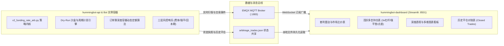

# 永续合约资金费率套利系统：全量知识沉淀与踩坑实战手册
> 本文档沉淀了项目从 0 到 1 架构设计、二次开发、实盘/模拟预演（Dry-Run）演进全过程的所有核心问答、技术决策、数学模型与重大踩坑经验，旨在作为后续任何新项目、策略迭代与 AI Agent 协作的永续基石。
> 关联全量会话交互档案：[`docs/INTERACTION_HISTORY.md`](file:///home/neo/projects/hummingbot/docs/INTERACTION_HISTORY.md)
> 关联工作区规则文件：[`AGENTS.md`](file:///home/neo/projects/hummingbot/AGENTS.md)

---

## 目录
1. [系统总体架构与设计意图](#一系统总体架构与设计意图)
2. [量化套利核心原理与两派流派辨析](#二量化套利核心原理与两派流派辨析)
3. [十大关键踩坑与技术避坑指南](#三十大关键踩坑与技术避坑指南)
4. [核心财务与风控数学指标手册](#四核心财务与风控数学指标手册)
5. [系统全生命周期运营与监控 SOP](#五系统全生命周期运营与监控-sop)

---

## 一、系统总体架构与设计意图

本项目由三大子系统组成，以高内聚、低耦合的松构架运行在 Ubuntu/Linux 环境与 Docker 容器中：

1. **`hummingbot-api`**：运行 Docker 容器化 Hummingbot 交易实例，执行策略计算、连接交易所网关、下达订单与运行风控逻辑。
2. **`hummingbot-dashboard`**：基于 Streamlit 构建的前端交互界面，提供策略配置管理、实例启停、多维盘口深度透视与财务收益流水对账。
3. **数据交换层**：策略通过文件挂载（`/home/hummingbot/data/arbitrage_trades.json`）与 MQTT 广播将底层每秒状态毫秒级透出至前端。

---

## 二、量化套利核心原理与两派流派辨析

永续合约资金费率套利（Funding Rate Arbitrage / Cash & Carry）的本质是：**利用不同交易所或标的之间永续合约的多空情绪不均衡（费率利差），通过一买一卖等额对冲完全消除标的资产价格涨跌风险，纯粹赚取资金费率利息现金流。**

在量化交易界，存在两种截然不同的流派：

| 维度 | 模式一：底仓收息流（当前系统模式） | 模式二：机会狙击流（专业监控雷达模式） |
| :--- | :--- | :--- |
| **交易哲学** | 资金绝不闲置，保持 100% 仓位持续吃息 | 绝大部分时间空仓躺平，只打“确定性高胜率战役” |
| **开仓时机** | 只要日化利差高于门槛（如 0.12%/天），结合回本周期评估随时建仓 | 紧盯全市场 200+ 标的，在结算前 15~30 分钟捕获异常失衡瞬间入场 |
| **利差目标** | 稳健常态利差（日息 0.15%~0.4%，年化 50%~150%） | 极端异常失衡（单期 8h 费率 1%~3%，年化 1000%+） |
| **进场成本考量** | **以时间换空间**：入场点差由 2~12 小时利息逐步抹平 | **单期暴利直接覆盖**：1 次结算收到的利息远大于双边开平仓总摩擦成本 |
| **持仓周期** | 中短线（数天），直到费率反转或触发轮动 | 超短线（1~2 个结算周期，通常 1~8 小时），吃完即撤 |
| **痛点与防范** | 必须防范**“为了吃芝麻利息倒贴大点差”**，必须设置**回本周期硬性拦截** | 信号出现频次较低，对自动化毫秒级并发下单速度要求极高 |

---

## 三、十大关键踩坑与技术避坑指南

### 1. Docker 容器与宿主机文件权限冲突（Errno 13 Permission Denied）
- **现象**：在 Dashboard 保存策略配置或读取状态时，报错 `Permission denied: /.../funding_arb_hyperliquid_binance_dry_run.yml`。
- **根因**：Hummingbot 官方镜像默认使用 `root` (UID 0) 运行并在挂载卷中创建文件，而宿主机开发用户是普通用户（`neo:neo`，UID 1000），导致宿主机进程无法修改或覆盖容器生成的文件。
- **避坑准则**：
  - 严禁直接使用 root 强制修改；
  - 维护工作区统一权限：使用 `docker run --rm -v $(pwd):/work alpine chown -R 1000:1000 /work` 批量修正映射目录所有权；
  - 在启动容器时优先保持 UID/GID 一致。

### 2. Hummingbot 原生不支持跨所永续合约 Paper 模拟的死穴
- **现象**：启动纸面模拟时，必须配置真实 API Key；如果配置为空，连接器直接初始化失败退市。
- **根因**：Hummingbot 原生 Paper Trade 仅针对现货（Spot）设计了虚拟撮合，永续合约（Perpetual）连接器必须通过 API 签名校验才能初始化。
- **避坑准则**：
  - 不能依赖原生 paper 模式；
  - 必须采用 **免 Key 公共连接器初始化 + 策略内部植入 Dry-Run 虚拟结算沙盒**（支持虚拟头寸、盘口实时滑点测算、1h/8h 定时利息结算流水生成）。

### 3. Hyperliquid WebSocket 资金费率解析 Bug
- **现象**：Hyperliquid 永续连接器无法动态更新最新资金费率，或者在解析推送数据时抛出异常。
- **根因**：上游 Hummingbot 官方版本在 `HyperliquidPerpetualAPIOrderBookDataSource` 中对 WS 返回的数据结构提取字段有硬编码失配。
- **避坑准则**：
  - 在策略启动钩子 `start()` 中动态注入 Monkey Patch：自动替换/修补 `_funding_rate_patch_applied`，拦截并修正 WebSocket 数据流。

### 4. 盘口滑点穿透与流动性陷阱（Slippage Disasters）
- **现象**：小市值币种（如 SAND、2Z 等）一旦设置固定单笔开仓 $10,000，开仓瞬间产生 -1% 甚至更大的盘口浮亏。
- **根因**：次级永续交易所盘口深度极浅，直接市价吃单会击穿买一卖一，导致滑点损失远超几天收到的利息。
- **避坑准则**：
  - **必须强制开启“基于流动性安全容量的动态开仓算法”**；
  - 采集双边交易所 Top 25 档订单簿累计深度，开仓额严禁超过安全容量（如深度 30%）；
  - `Safe_Capacity = min(Depth_1, Depth_2) * 0.3`。

### 5. 跨所异步结算周期错位（Asymmetric Settlement Cycles）
- **现象**：刚开仓 1 小时，查看累计已收资金费，居然是负的！用户产生恐慌。
- **根因**：Hyperliquid 是 **1 小时结算**，Binance 是 **4/8 小时结算**。在开仓前 7 小时内，Hyperliquid 已经结算扣除了多头利息，而 Binance 的空头利息还没到结算点。
- **避坑准则**：
  - UI 必须明确提示账期差异；
  - 不能以单次结算评判好坏，必须以 **8 小时完整对齐周期** 作为收益衡量基准。

### 6. 名义总货值 vs 实际投入本金的财务换算误区
- **现象**：用户认为“投入 $12,000 本金开 3 倍杠杆，合约实际价值应该等于 $12,000 * 3 = $36,000，为什么系统显示 18,000？”
- **根因**：对冲套利是**双边开仓**！$12,000 本金被均分到两个交易所（多头 $6,000，空头 $6,000）。3 倍杠杆下，单边名义头寸为 $18,000，双边总持仓货值为 $36,000。
- **避坑准则**：
  - 在前端必须区分：
    - `单边名义货值 (Single-leg Notional)` = $18,000；
    - `双边合计货值 (Total Gross Notional)` = $36,000；
    - `真实投入保证金 (Total Margin)` = $12,000。

### 7. 开仓即浮亏（Entry Spread Friction）与回本周期黑洞
- **现象**：每次开仓后，盘口盈亏全都是负数。
- **根因**：两家交易所买一与卖一存在固定点差（Spread），外加双边 Taker 手续费（约 0.08%~0.10%）。
- **避坑准则**：
  - **严禁为了万分之五的利差，支付千分之五的摩擦成本**；
  - **设立回本周期拦截器（Payback Period Barrier）**：若 `回本时间 = 入场总点差与手续费 / 每小时息差 > 12 小时`，系统必须坚决放弃开仓。

### 8. 僵尸标的赖账与资金占用（Low-Yield Zombie Traps）
- **现象**：开仓时费率很高，持有几天后费率衰减至年化 2%~9%（如 RSR、MOODENG），占着上万美元本金无法自拔。
- **根因**：缺乏主动淘汰与轮动机制。
- **避坑准则**：
  - 设定最低利差维持线（如 `0.12%/天`）；
  - 一旦标的被移出配置或利差萎缩，系统触发平仓退出（`Manual Rotation: Low Yield Ditch`），将历史记录结转至 `closed_trades`，释放保证金复用。

### 9. 单边暴涨暴跌引发的单腿强平爆仓风险
- **现象**：虽然双边价值完全对冲，但某一边交易所账户因暴涨/暴跌亏空保证金而遭遇交易所强制平仓。
- **根因**：未实现盈亏在两边不对称，盈利在 A 交易所但无法实时转入 B 交易所补充保证金。
- **避坑准则**：
  - 严格限制杠杆倍数（推荐 2x~3x，严禁高杠杆）；
  - **内置强平防御（Liquidation Defense）**：实时监测 `min_liq_distance_pct`，一旦距离强平线 `<= 8%`，无条件提前主动平仓防爆。

### 10. 前端 Streamlit 页面高频刷新闪烁与状态丢失
- **现象**：Dashboard 定时刷新时，图表与表格一明一暗甚至抖动。
- **根因**：全局 `st.rerun()` 重新加载了整个 DOM 树。
- **避坑准则**：
  - 采用 Streamlit `st.fragment` 局部刷新机制；
  - 对只读静态资源缓存；保持数据拉取与 DOM 渲染解耦。

---

## 四、核心财务与风控数学指标手册

### 1. 强平价格与强平距离测算
对于维持保证金率 $MMR$（默认 2%），开仓价 $P_{open}$，杠杆倍数 $L$：
- **多头强平价**：
  $$P_{liq}^{Long} = P_{open} \times \left(1 - \frac{1}{L} + MMR\right)$$
- **空头强平价**：
  $$P_{liq}^{Short} = P_{open} \times \left(1 + \frac{1}{L} - MMR\right)$$
- **安全强平垫**：
  $$Dist_{pct} = \frac{|P_{curr} - P_{liq}|}{P_{curr}}$$
  - **警戒线**：$Dist_{pct} \le 8\%$ 立即触发强平防御退出。

### 2. 回本周期与开仓性价比（模式一关键规则）
- **入场总摩擦成本率**：
  $$Friction = \frac{|P_{entry1} - P_{entry2}|}{P_{avg}} + Fee_{c1} + Fee_{c2}$$
- **每小时预期息差收益率**：
  $$Yield_{hourly} = \frac{\Delta Rate_{daily}}{24}$$
- **回本小时数**：
  $$Payback_{hours} = \frac{Friction}{Yield_{hourly}}$$
  - **拦截规则**：若 $Payback_{hours} > 12.0\text{ 小时}$，**拒绝开仓**！

### 3. 动态容量算法
$$Size_{quote} = \min\left(Size_{target}, \sum_{k=1}^{25} (P_k \times Q_k)_{c1} \times 0.3, \sum_{k=1}^{25} (P_k \times Q_k)_{c2} \times 0.3\right)$$

---

## 五、系统全生命周期运营与监控 SOP

1. **每日盘面巡检**：
   - 检查 Dashboard 顶栏总现金流预期与总 ROE。
   - 检查是否有标的处于“回本倒贴”或利差接近 0。
2. **标的淘汰与轮动**：
   - 每日运行全市场比价，若发现有年化 > 100% 的新星，将老旧僵尸币从 `tokens` 列表中剔除，加入新币。
   - 重启容器或触发自动轮动，系统会自动安全平仓旧币并入账历史账本。
3. **资金安全与异常处置**：
   - 若某标的强平垫接近 10%，策略将自动平仓退出；人工无需恐慌，检查历史平仓原因即可确认。
