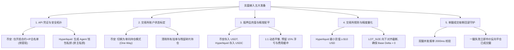

# 实盘接入全面审计与生产落地指南 (From Dry-Run to Live Trading)

本文档针对 Hummingbot 基差与资金费率套利系统从 **模拟运行（Dry-Run / Paper Trading）** 切换至 **真实资金实盘交易（Live Real Trading）** 进行全方位的接口完整性审计、风险拦截评估与标准化切换 SOP。

---

## 1. 核心结论与总决断 (Executive Summary)

| 审计维度 | 现状评估 | 能否直接切换？ | 核心阻塞点 / 风险说明 |
| :--- | :--- | :--- | :--- |
| **策略逻辑接口** | ✅ 95% 就绪 | ❌ 不能 | `PositionExecutor` 具备双边下单能力，但**缺少单腿失败立即反向平仓的熔断回滚守护（Single-Leg Rollback）**。 |
| **交易所底层连接器** | ⚠️ 代码完备，密钥未配 | ❌ 不能 | `binance_perpetual` 与 `hyperliquid_perpetual` 均为官方内置成熟模块，但实例环境无任何 API Key。 |
| **API 与实例调度层** | ✅ 100% 就绪 | ❌ 不能 | `hummingbot-api` 已具备 `/connectors/add-credentials` 接口，但未绑定真实主账户与子账户。 |
| **资金与账户状态** | ❌ 0% 未接入 | ❌ 不能 | 币安与 Hyperliquid 均为零余额或未开通；币安持仓模式未标定为 One-Way；未生成专属 API Agent 钱包。 |

> [!CAUTION]
> **红线决断：坚决不能仅靠修改 `dry_run: false` 直接切换实盘！**
> 若在未完成凭证加密注入、账户状态标定、双边抵押品配平以及单腿回滚防护前盲目打开实盘，会导致容器启动报错崩溃、交易所拒绝下单，甚至在极端行情下发生**“一腿成交、另一腿被拒”导致的 100% 裸方向投机敞口**，造成严重资金穿透风险。

---

## 2. 接口完整性全维深度审计 (Interface Completeness Audit)

### 2.1 策略内部执行接口 (Strategy Engine Layer)
- **已完备组件**：
  1. **市场行情与深度聚合**：已通过 WebSocket 订阅 Binance 与 Hyperliquid 的 Top 25 档订单簿、最新成交价与资金费率。
  2. **保证金预检拦截器 (`get_connector_available_collateral`)**：已支持查询 Binance 的 USDT/USDC 以及 Hyperliquid 的 USD/USDC 真实可用余额，并设置了 5% 缓冲垫与手续费预扣。
  3. **持仓模式与杠杆初始化 (`init_markets` / `__init__`)**：代码中已有 `connector.set_position_mode(PositionMode.ONEWAY)` 与 `connector.set_leverage(tp, config.leverage)`。
  4. **标准 StrategyV2 执行器调度**：已集成 `PositionExecutorConfig`、`CreateExecutorAction` 与 `StopExecutorAction`。
- **缺失与需加固接口**：
  1. **单腿成交失败回滚机制 (Single-Leg Unwind Guard)**：
     - 当前代码在发出 `CreateExecutorAction` 时，直接在本地记录仓位。
     - 若 Leg 1 市价单在 Binance 瞬间成交，而 Leg 2 在 Hyperliquid 因网络丢包、价格跳动超过限价滑点或最小金额过滤被交易所 `REJECT`，当前系统缺乏一个高优先级的**“单腿超时未成交立即以市价斩仓已成交腿”**的原子回滚守护。

### 2.2 交易所连接器与鉴权接口 (Exchange Connector & Auth Layer)
- **Binance Perpetual (`binance_perpetual`)**：
  - **接口类型**：HMAC-SHA256 签名的 REST + WebSocket。
  - **所需字段**：
    * `binance_perpetual_api_key`
    * `binance_perpetual_api_secret`
  - **现状**：代码接口完全匹配，但缺少生产 API Key 配置文件。
- **Hyperliquid Perpetual (`hyperliquid_perpetual`)**：
  - **接口类型**：EIP-712 签名，支持主钱包或 API Agent 钱包。
  - **所需字段**：
    * `hyperliquid_perpetual_mode`: `"api_wallet"` (推荐) 或 `"arb_wallet"`
    * `use_vault`: `"no"`
    * `hyperliquid_perpetual_address`: 主钱包 Arbitrum 地址 (0x...)
    * `hyperliquid_perpetual_secret_key`: 授权给该地址的 Agent 私钥 (0x...)
  - **现状**：代码支持 Arbitrum L1/L2 交互，但尚未在 Hyperliquid 网页前端完成 Agent 授权签名。

---

## 3. 必须全面接入与准备的五大领域 (The 5 Prerequisites for Live Trading)

### 领域 1：API 凭证与安全拓扑隔离 (Security Architecture)
1. **币安（Binance Futures）**：
   - 登录 Binance 官网，进入 API 管理；
   - 权限勾选：**仅勾选“允许合约交易（Enable Futures）”**与“读取数据”；
   - **绝对禁止勾选“允许提现（Enable Withdrawals）”**；
   - 必须配置 IP 访问限制（绑定 VPS 的固定公网 IP）。
2. **Hyperliquid（Arbitrum L2）**：
   - **绝不能将主钱包的助记词或私钥存入服务器！**
   - 打开 `https://app.hyperliquid.xyz/API`；
   - 连接主钱包，点击 `Authorize API Agent`；
   - 系统会生成一个专门用于自动化下单的 Agent 临时私钥与地址，并由主钱包完成链上 EIP-712 签名授权；
   - 该 Agent 钱包**只有下单权限，没有任何提取主钱包本金的链上权限**。

### 领域 2：交易所账户状态标定 (Account Pre-flight Standardization)
1. **币安持仓模式（Position Mode）**：
   - 币安合约默认可能为“双向持仓（Hedge Mode）”；
   - 必须手动在币安合约偏好设置中修改为 **“单向持仓模式（One-Way Mode）”**；
   - 如果账户里有未平仓的历史仓位或未撤销的挂单，修改持仓模式会失败，必须全部清理。
2. **币安保证金模式（Margin Mode）**：
   - 建议在全仓（Cross）或带安全垫的逐仓模式下运行。

### 领域 3：抵押品充值与精准配平 (Collateral Balancing)
1. **资金配平原则**：
   - 对冲套利要求双边头寸等额。如果一方有 $1000，另一方只有 $100，最大有效套利额度仅为 $100。
   - 币安合约存入 **USDT**，Hyperliquid 存入 **USDC**（通过 Arbitrum 主网直接充值）。
   - 建议初始双边按照 **1:1** 配比注资。
2. **安全垫与留存水位**：
   - 单边账户保证金利用率严禁超过 70%；
   - 留存 30% 应对不利的未结算盈亏波动，以及每天可能支付的资金费。

### 领域 4：交易规则与最小面额过滤 (Trading Rules & Sizing Filters)
1. **最小货值（Min Notional）底线**：
   - Binance 每笔订单通常限制名义价值 $\ge \$5$ USD；
   - Hyperliquid 每笔订单限制名义价值 $\ge \$10$ USD；
   - **生产配置规范**：策略配置文件中的 `min_order_size_quote` 必须 $\ge 10.0$ USD，单笔名义货值 `position_size_quote` 建议设置为 $\ge 15.0$ USD。
2. **数量精度与步长量化（Step Size Quantization）**：
   - 代币数量必须满足交易所的 `step_size`（如 SOL 只能精确到 0.01，BTC 只能到 0.001）；
   - 必须在下单前调用连接器的 `quantize_order_amount` 进行向下截断，防止由于精度超标导致交易所返回 `Filter Failure: LOT_SIZE`。

### 领域 5：单腿成交熔断回滚守护 (Single-Leg Execution Rollback Guard)
1. **风险场景**：
   - 在高并发或网络抖动时，Binance 腿以市价秒级成交，而 Hyperliquid 腿因 RPC 超时或盘口瞬移被拒。
   - 此时系统持有单向投机敞口（Naked Leg），一旦行情单边暴涨暴跌，套利变巨亏。
2. **加固防护逻辑**：
   - 监控两个 `PositionExecutor` 的生命周期；
   - 若发出订单后 2~3 秒内，一腿状态为 `FAILED` 或未成交，策略必须立即向已成交的一腿发出市价反向平仓单，撤销未完成单，并打上 `SINGLE_LEG_ABORT` 标记，锁定最小摩擦损耗，杜绝裸奔。

---

## 4. 标准化实盘切换与落地三步走 SOP (Staged Transition Roadmap)

### 阶段一：Paper 模拟盘（当前状态 - 已达成）
- **规模**：虚拟资金 $1,000 USD，48 个代币池；
- **目标**：验证基差收敛算法、60 秒防噪锁定期、动态容量定额与前端看板对账；
- **当前战果**：已平仓 73 笔，净利润 +$23.12 USD，胜率 94.5%，实测 60s 锁定期保护收益显著。

### 阶段二：微额影子实盘验证（Micro-Live Staging - 关键过渡）
- **规模与标的**：
  * 总本金：双边各充入 **$50~$100 USD**；
  * 单笔货值：`position_size_quote: 15.0` USD，`leverage: 3`（实缴保证金仅需 $5 USD/笔）；
  * 限制币种池：收窄至流动性最强、点差最小的 **2~3 个主流币**（如 `SOL`, `ETH`）；
- **执行动作**：
  1. 通过 API 配置真实的 Binance API Key 与 Hyperliquid Agent 钱包私钥；
  2. 启动专用微额实盘实例配置：`basis_stat_arb_hyperliquid_binance_micro_live.yml`；
  3. 观察首批 5~10 笔真实订单的双边成交速度、真实滑点、交易所实际扣除的手续费（区分 VIP 等级或返佣）以及实际收到的资金费离散现金流；
  4. 验证单腿成交异常情况下的自动化处置。

### 阶段三：规模化正式生产实盘（Full Production Live）
- **规模**：根据实际风险承受能力扩大本金；
- **动态扩容**：将币种池从 3 个放宽至 15~20 个；
- **风控巡检**：
  * 配合 VPS Headless 无头模式后台守护；
  * 每日通过远程 SSH 隧道对账前端看板，复盘真实平仓失败归集与 Alpha 留存率。
