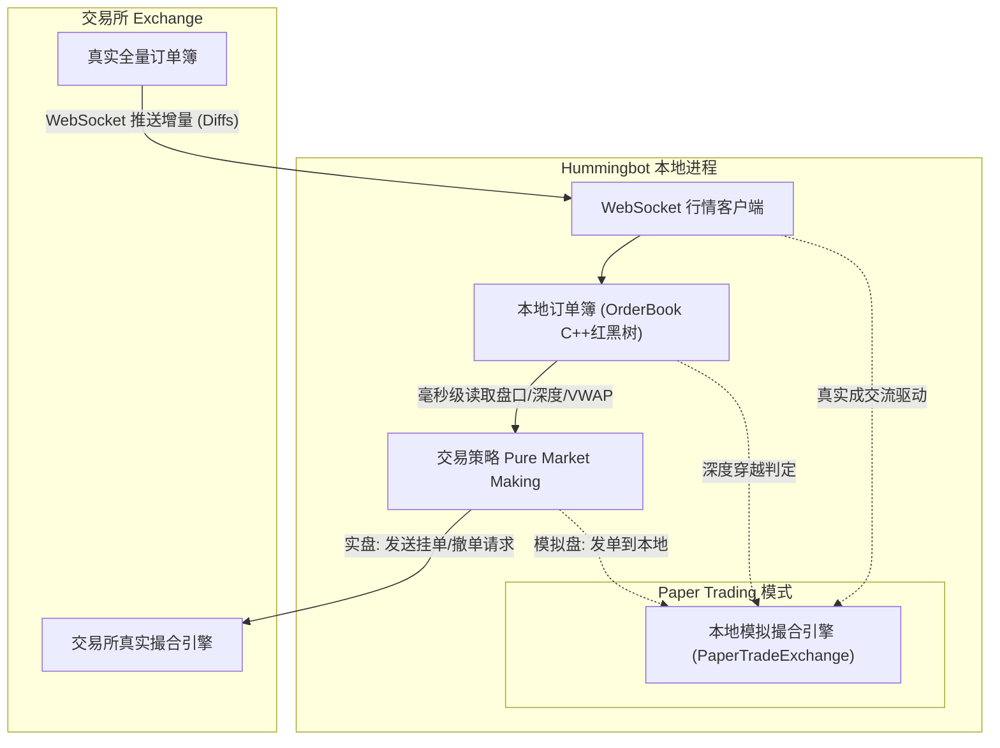

# 阶段零：Hummingbot 订单簿底层机制认知

- **会话标识 (Conversation ID)**: `88380058-b7b9-460c-9fd0-f8704b9b09c6`
- **时间跨度**: `2026-10-17 09:12 ~ 09:17`

---

### 交互 1
- **提问时间**: `2026-10-17T09:15:46Z`

#### 👤 用户原始提问 (User Request):

```text
我不是很明白，Hummingbot这个系统为什么需要订单簿撮合？订单簿撮合不是在交易所里面做的吗？难道还要在本地做订单簿吗？
```

#### 🤖 Assistant 完整回答 (Full Response):

这是一个非常好的问题！很多初次接触量化交易或阅读 Hummingbot 源码的开发者都会产生类似的疑惑：**“撮合不都是交易所撮合引擎干的活吗？为什么一个交易客户端还要在本地搞订单簿甚至撮合？”**

答案的核心在于两点：
1. **在实盘交易中，Hummingbot 绝不会替交易所去撮合真实订单**（撮合 100% 在交易所内部发生）。
2. 之所以在源码中看到“撮合”与“本地订单簿”，是因为**「模拟盘（Paper Trading）」**与**「高频做市决策」**的刚性需求。

---

### 一、 为什么 Hummingbot 本地会有“撮合”（Matching）逻辑？

你在 Hummingbot 代码中看到的撮合逻辑（比如 [`PaperTradeExchange`](file:///home/neo/projects/hummingbot/hummingbot/connector/exchange/paper_trade/paper_trade_exchange.pyx#L143)），主要用于以下两个场景：

#### 1. 模拟交易（Paper Trading / 回测）的虚拟撮合引擎
量化策略上线前必须经过仿真验证。如果不想用真金白银测试策略，你可以开启 Paper Trading 模式：
* 此时 Hummingbot 会订阅交易所真实的行情（真实深度与真实成交数据），但**绝不会把订单真实发送给交易所**。
* 那么你挂在盘口上的虚拟买卖单，由谁来判定“成交”？——只能由 Hummingbot 本地充当“模拟交易所”来做撮合：
  * **价格穿透撮合**：当真实市场的对手盘价格穿过了你在本地挂的限价单价格（参见 [`c_process_crossed_limit_orders`](file:///home/neo/projects/hummingbot/hummingbot/connector/exchange/paper_trade/paper_trade_exchange.pyx#L836-L875)），本地引擎判定你的订单成交。
  * **逐笔交易匹配**：监听真实市场的成交流（Trades），当市场真实成交价格落在你挂单的价格区间时（参见 [`c_match_trade_to_limit_orders`](file:///home/neo/projects/hummingbot/hummingbot/connector/exchange/paper_trade/paper_trade_exchange.pyx#L895-L940)），本地触发成交事件。

#### 2. 市价单执行与滑点预估（Execution Simulation）
做市和套利策略（例如跨市场套利 Cross-Exchange Market Making）经常需要估算成本：
* 假设当 Exchange A 的挂单成交后，需要立即在 Exchange B 发市价单平仓对冲。
* Hummingbot 在下发市价单前，会在本地订单簿中运行 [`simulate_buy`](file:///home/neo/projects/hummingbot/hummingbot/core/data_type/order_book.pyx#L300-L309) 或 [`c_get_vwap_for_volume`](file:///home/neo/projects/hummingbot/hummingbot/core/data_type/order_book.pyx#L341-L372)，**在本地模拟吃掉当前盘口深度**，提前测算出实际成交均价（VWAP）与滑点（Slippage）。如果滑点过大导致吃掉利润，策略就会立刻放弃本次操作。

---

### 二、 难道还要在本地做（维护）订单簿吗？

**是的，不仅要做，而且这是所有高频做市（Market Making）系统的生命线。**

很多初学者的直觉是：“我要下单的时候，发一个 HTTP REST 请求查一下交易所当前买一卖一价格不就行了吗？”。在量化做市中，这种做法是完全不可行的：

| 维度 | 通过 REST API 轮询查询 | 本地维护订单簿（Local Order Book） |
| :--- | :--- | :--- |
| **延迟** | 每次查询需要 50~300ms（受网络 RTT 和交易所处理影响） | 本地内存红黑树查找，耗时 **< 1 微秒（$\mu s$）** |
| **API 频次限制 (Rate Limit)** | 极易触发交易所限频（429 Too Many Requests），导致 IP 被封禁 | 建立长连接后由 WebSocket 推送，**完全不消耗 REST 请求额度** |
| **时效性与防被套** | 拿到的行情是过去的“旧切片”，极易被其他套利者逆向选择（捡便宜） | 交易所一有增量（Diff），毫秒级在本地同步，策略即刻撤单重挂 |

#### Hummingbot 是如何在本地维护订单簿的？
1. **拉取快照（Snapshot）**：启动时通过 REST API 拿到全量订单簿（例如买卖各 500 档）。
2. **订阅增量（Diff Streams）**：建立 WebSocket 长连接，监听交易所推送的每一笔挂单新增、修改与撤销。
3. **C++/Cython 维护内存镜像**：Hummingbot 的 [`OrderBookTracker`](file:///home/neo/projects/hummingbot/hummingbot/core/data_type/order_book_tracker.py#L20) 接收增量消息，交由底层的 [`OrderBook`](file:///home/neo/projects/hummingbot/hummingbot/core/data_type/order_book.pyx#L39)（底层为 C++ `std::set`）实时更新。
4. **策略零开销计算**：做市策略（如纯做市 Pure Market Making）每一 tick 都能直接从本地内存瞬间算出中间价（Mid Price）、订单簿失衡度（Order Book Imbalance）和多档价格深度。

---

### 三、 整体架构关系图



### 总结
* **订单簿在本地**：是为了**快**（微秒级本地计算）和**省**（不消耗 API 频次），实现交易所盘口在本地内存的 1:1 实时镜像；
* **撮合在交易所**：实盘时你的订单由交易所的撮合引擎决定能否成交；
* **撮合在本地**：只发生在 **模拟盘（Paper Trading）** 仿真测试或 **滑点预估（Simulation）** 阶段。

---

